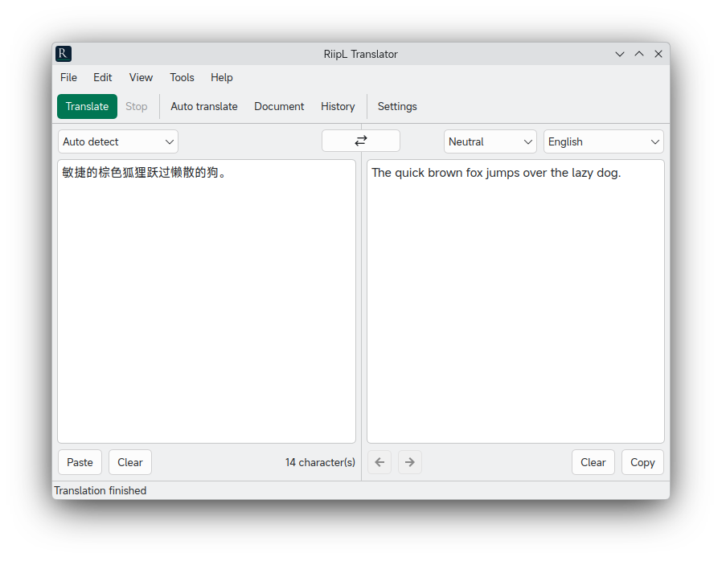

<div align="center">


# RiipL

**Lightning-fast, all-in-one desktop translator**


**English** | [中文](README.zh-CN.md)



[Introduction](#introduction) · [Features](#features) · [Installation](#installation) · [Build](#manual-build) · [Notes](#additional-notes)

</div>

## Introduction

RiipL is an extremely lightweight, lightning-fast, all-in-one cross-platform desktop translation app. It connects to **any OpenAI-compatible API** to power translation and other advanced features.

RiipL shamelessly, brutally rips off and implements most of [DeepL Translator](https://www.deepl.com/products/translator)'s flagship paid features, including but not limited to translation notes, glossaries, wording alternatives, and long-document translation. You no longer need to subscribe to [expensive DeepL Pro](https://www.deepl.com/pro), nor do you have to endure their slow web page loading.

RiipL is deeply integrated with the desktop environment and local workflows, thoroughly optimized for professional scenarios such as batch translation, extremely long documents, and fast real-time translation.

Built with high-performance C++ and Qt, unlike heavy clients based on Node.js-derived stacks or rendered with browser engines, RiipL compiles to a binary size of only about **1 MB**, cold-starts in milliseconds, and uses negligible memory.

Parts of RiipL's code were written by AI agent under human supervision, and have undergone human review.

## Features

- **Flexible Model Providers**: Connect to OpenAI, Ollama, LM Studio, llama.cpp, and other compatible endpoints. Supports auto-fetching model configurations and saving multiple API presets for quick switching between different models and endpoints.

- **Multilingual Support**: Built-in support for over 40 common languages, with options to add custom languages or dialects.

- **Long-Document Translation**: Supports translating extremely long documents, with flexible configuration of glossaries, background information, tone, personas, and more.

- **Glossary**: Define domain-specific terms to ensure strict model adherence, with support for importing and exporting JSON files.

- **Tone, Style & Background**: Built-in preset tones with support for adding and reordering custom tones. Supports entering custom style guides and background knowledge, with multiple context presets saved for easy switching across different scenarios.

- **YOLO Mode**: Automatically monitors and translates clipboard content in the background and writes it back, preserving original formatting for seamless in-place replacement at the source.

- **Wording Alternatives**: Click any word in the translation to view multiple candidate alternatives, complete with full undo and redo support.

- **Open Prompt Pipeline**: Standalone, freely editable templates for system prompts, tones, glossaries, and long documents, complete with a real-time preview window to inspect the full prompt.

- **Translation History**: Automatically saves translation records, with keyword search and quick reuse.

## Installation

### Linux (Arch-based)

- Release branch:

  ```shell
  yay -S riipl
  ```

- Mainline branch:

  ```shell
  yay -S riipl-git
  ```

### Other Linux Distributions

Download pre-built packages from [Releases](https://github.com/KFERMercer/RiipL/releases/latest).

### macOS & Windows

See [Manual Build](#manual-build).

## Manual Build

### Prerequisites

| Dependency | Version |
| :- | :- |
| Qt 6 (Widgets, Network, Svg, LinguistTools) | 6.8+ |
| CMake | 3.21+ |
| C++ compiler | C++17 capable (GCC, Clang, MSVC) |

Debian / Ubuntu:

```bash
sudo apt install build-essential cmake qt6-base-dev qt6-tools-dev qt6-l10n-tools qt6-svg-dev
```

Windows and macOS need a regular Qt 6 installation (online installer or `brew install qt cmake`), and use `windeployqt` / `macdeployqt` respectively for deployment.

### Compile

```bash
cmake -S . -B build -DCMAKE_BUILD_TYPE=Release
cmake --build build --clean-first -j$(nproc)
```

After a successful build, the executable is located at `./build/riipl`.

## Additional Notes

- Translation quality and the stable operation of certain features partially depend on the connected model's capabilities. RiipL's optimization baseline is [`tencent/Hy-MT2-7B`](https://huggingface.co/tencent/Hy-MT2-7B); models less capable than this may be unstable in operation.
- API keys are stored in plain text inside `config.json`; protect this file as needed.
