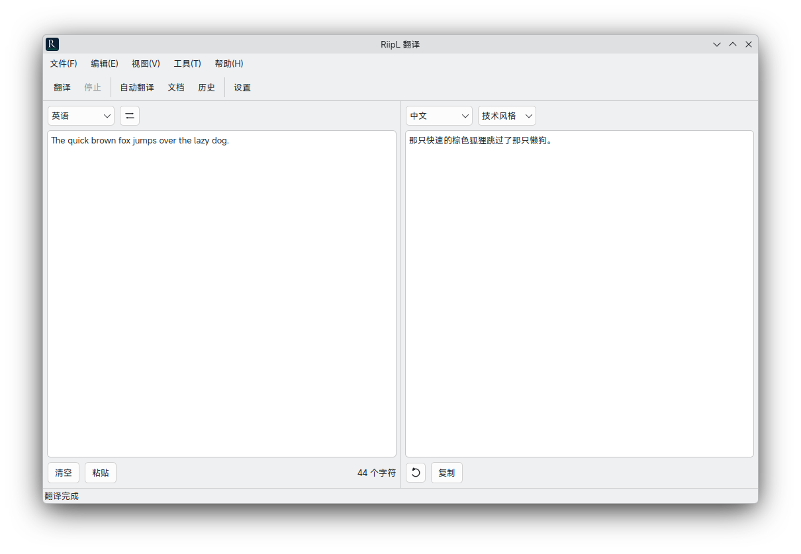

<div align="center">


# RiipL

**快如闪电的全能桌面翻译器**


[English](README.md) | **中文**



[简介](#简介) · [功能](#功能) · [安装](#安装) · [构建](#手动构建) · [其他](#其他说明)

</div>

## 简介

RiipL 是一款极端轻量、快如闪电的全能跨平台桌面翻译应用。通过**接入任何 OpenAI 兼容接口**来驱动翻译和其他高级功能。

RiipL 毫不掩饰、厚颜无耻、无法无天地抄袭并实现了 [DeepL 翻译器](https://www.deepl.com/products/translator) 的大部分拳头付费功能。包括但不限于翻译笔记、术语本、遣词替代、长文档翻译等。你不需要再订阅[昂贵的 DeepL 会员](https://www.deepl.com/pro)，也不再需要痛苦等待他们缓慢的网站加载。

RiipL 与桌面环境和本地工作流深度集成。对批量翻译、极长文档翻译、快速实时翻译等专业场景做了深入优化。

RiipL 基于高效的 C++ 与 Qt 构建。与 Node.js 衍生技术栈和基于浏览器引擎渲染的沉重客户端不同，RiipL 编译后的程序大小仅约 **1MB**，冷启动仅需数毫秒，内存使用可忽略不计。

RiipL 的部分代码由人类监管下的 AI Agent 编写，并通过了人类审查。

## 功能

- **自由选择模型提供商**：支持接入 OpenAI、Ollama、LM Studio 和 llama.cpp 等兼容接口。支持自动获取模型配置与保存多套 API 预设，方便在不同模型与端点之间快速切换。

- **多语言支持**：内置 40 余种常用语言，并可额外添加自定义语言或方言。

- **长文档翻译**：支持极长文档翻译，并可自由配置术语表、背景信息、语气、角色等。

- **术语表**：支持自定义专业术语来确保模型严格遵循。并可导入和导出到 JSON 文件。

- **语气、风格与背景**：内置多种预设语气，支持添加和排序自定义语气。支持输入自定义风格指南与背景知识，可保存多套上下文预设，方便在不同场景间切换。

- **YOLO 模式**：后台自动监听并翻译剪贴板中的内容并回写到剪贴板，自动保持原文本格式，确保直接可在来源处原位替换。

- **遣词替代**：点击译文中单词即可给出数种候选替换方案。并支持完整的撤销与重做。

- **开放的提示词管线**：系统提示词、语气、术语和长文档均有可自由编辑的独立模板。并提供实时预览窗口预览完整提示词。

- **翻译历史**：自动保存翻译记录。支持通过关键词搜索并快速重用。

## 安装

### Linux (Arch based)

- 发布分支：

  ```shell
  yay -S riipl
  ```

- 主线分支：

  ```shell
  yay -S riipl-git
  ```

### 其他 Linux 发行版

前往 [Releases](https://github.com/KFERMercer/RiipL/releases/latest) 下载预构建文件。

### macOS 与 Windows

参考[手动构建](#手动构建)。

## 手动构建

### 环境要求

| 依赖 | 版本 |
| :- | :- |
| Qt 6（Widgets、Network、Svg、LinguistTools） | 6.8+ |
| CMake | 3.21+ |
| C++ 编译器 | 支持 C++17（GCC、Clang、MSVC） |

Debian / Ubuntu：

```bash
sudo apt install build-essential cmake qt6-base-dev qt6-tools-dev qt6-l10n-tools qt6-svg-dev
```

Windows 与 macOS 安装常规 Qt 6（在线安装器或 `brew install qt cmake`），
部署时分别使用 `windeployqt` / `macdeployqt`。

### 编译

```bash
cmake -S . -B build -DCMAKE_BUILD_TYPE=Release
cmake --build build --clean-first -j$(nproc)
```

编译成功后的可执行文件位于 `./build/riipl`

## 其他说明

- 翻译质量以及部分功能的稳定工作部分取决于所连接的模型质量。RiipL 的模型优化基线是 [`tencent/Hy-MT2-7B`](https://huggingface.co/tencent/Hy-MT2-7B)，能力低于此的模型在工作时可能不稳定。
- API 密钥以明文形式存放在 `config.json`，如有必要请自行保护该文件。
